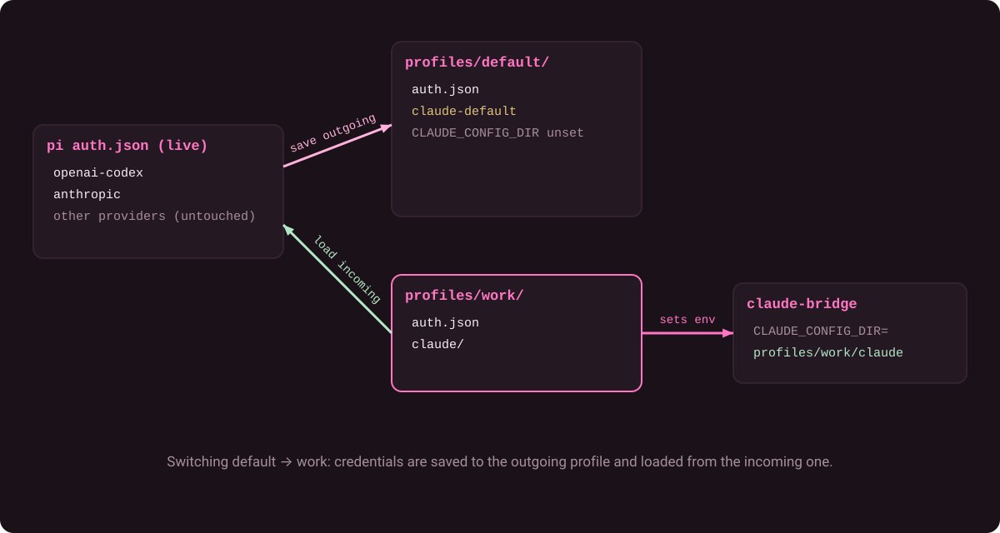

<p align="center"></p>

[Español](https://github.com/fcireza/gentle-accounts/blob/main/README.md) | English

**One login per account, once.** Each profile keeps its own Claude, Codex and Anthropic session in Gentle Shell and pi. Switch from the menu or with one command and never log in again: the status bar always shows which account is active.

<p align="center">
  <a href="https://github.com/fcireza/gentle-accounts/releases"></a>
  <a href="https://github.com/fcireza/gentle-accounts/blob/main/LICENSE"></a>
  <a href="https://pi.dev"></a>
</p>

<p align="center">
  <a href="https://github.com/Gentleman-Programming/gentle-ai"></a>
</p>

## Documentation

- [Index](https://github.com/fcireza/gentle-accounts/blob/main/docs/en/README.md): starting point of the documentation.
- [Installation](https://github.com/fcireza/gentle-accounts/blob/main/docs/en/install.md): every system, Gentle Shell and pi, alias, update and remove.
- [Workflow](https://github.com/fcireza/gentle-accounts/blob/main/docs/en/workflow.md): complete scenarios with images.
- [Commands](https://github.com/fcireza/gentle-accounts/blob/main/docs/en/commands.md): full reference with every message.
- [How it works](https://github.com/fcireza/gentle-accounts/blob/main/docs/en/how-it-works.md): disk layout, switching, status bar and security.
- [Troubleshooting](https://github.com/fcireza/gentle-accounts/blob/main/docs/en/troubleshooting.md): symptoms, causes and fixes.
- [Development](https://github.com/fcireza/gentle-accounts/blob/main/docs/en/development.md): tests, CI, Conventional Commits and releases.

## Objective

Claude Code keeps one login per machine, and pi keeps your Codex and Anthropic credentials in a single `auth.json`. gentle-accounts lets you keep named **profiles**, such as `work` and `personal`, each with its own logins. You switch between them with one command and the status bar always shows which account is active.

## How it works

1. Each profile (`work`, `personal`…) keeps its own login: its Claude Code folder (`CLAUDE_CONFIG_DIR`) and its own OAuth credentials file. Think of one drawer per account. On macOS and Linux pi's `auth.json` is only a shortcut (a link) to the drawer of the active profile: switching moves the shortcut and copies nothing, and a token pi renews is saved in the right profile. On Windows the credentials are still copied. A `/login` made directly in pi lands in the active profile and replaces its token: to add another account, use the accounts menu or `gentle-accounts <profile>`.
2. Switching profile, with `/gentle:accounts <name>` or from the menu, swaps that folder and those credentials and refreshes the status bar.
3. You log each provider in once per profile; after that the profile remembers it, with no new login while the token is alive.
4. `gentle-accounts <profile>` starts a session with a private agent folder, so two projects use two accounts at the same time. Avoid the SAME account in two sessions: refresh tokens rotate and one can be invalidated.
5. Profiles stay on disk under `profiles/`, inside the agent folder. More in [How it works](https://github.com/fcireza/gentle-accounts/blob/main/docs/en/how-it-works.md).



## Providers

| Provider | What each profile keeps | How to log in |
| --- | --- | --- |
| Claude (through [pi-claude-bridge](https://github.com/elidickinson/pi-claude-bridge)) | its own Claude Code session (a separate `CLAUDE_CONFIG_DIR`) | `Enter` on its menu row: new tab (recommended), this terminal or show the command; or `/gentle:accounts login claude` |
| Codex (`openai-codex`) | its own credentials in pi's `auth.json` | `Enter` on its menu row: this terminal (recommended), new tab or show the command |
| Every other OAuth login (Anthropic and any provider that `/login` offers) | its own credentials in pi's `auth.json` | same as Codex |

API-key providers stay global; every account (OAuth) provider belongs to the profile.

## Commands

The accounts menu is the main way to use it: `/gentle:accounts` lists the profiles and, with `→`, their providers; `Enter` switches or logs in, `n` creates, `r` renames, `d` deletes, `s` sets the session profile, `e` toggles the email, `g` opens the account usage box, `x` logs a provider out, `i` adopts a detected login, `o` opens the project with that profile in a tab and `Esc` closes. In `fullscreen` the mouse and the wheel work too.

| Command | What it does |
| --- | --- |
| `/gentle:accounts` | Opens the accounts menu. |
| `/gentle:accounts help` | Shows the usage. |
| `/gentle:accounts <name>` | Switches to `<name>`. |
| `/gentle:accounts list` | Lists the profiles. |
| `/gentle:accounts create <name>` | Creates an empty profile. |
| `/gentle:accounts session [<name>\|last]` | Shows, sets or clears the profile new sessions start on. |
| `/gentle:accounts email [show\|hide]` | Shows or hides the full email in the status bar. |
| `/gentle:accounts usage [on\|off]` | Opens the `Account Usage` overlay (what each account's providers already reported), or turns it on or off. `usage all` opens the native `/gentle:usage` first and this panel after it closes (key `a` in the menu). |
| `/gentle:accounts delete <name>` | Deletes a profile, after a confirmation. |


First use:

```sh
/gentle:accounts create work
/gentle:accounts work
/gentle:accounts
```

Every message and the rest of the launcher subcommands are in [Commands](https://github.com/fcireza/gentle-accounts/blob/main/docs/en/commands.md).

## Install

Requirements: Node 22.18 or newer, pi 1.5.1 or newer (or Gentle Shell), the `claude` CLI and pi-claude-bridge for Claude profiles.

### macOS / Linux

With Gentle Shell or with pi:

```sh
gentle-shell install git:github.com/fcireza/gentle-accounts
```

```sh
pi install git:github.com/fcireza/gentle-accounts
```

### Windows (PowerShell)

**Windows has not been tested on a real machine**, only by automated tests; WSL is recommended.

```powershell
gentle-shell install git:github.com/fcireza/gentle-accounts
```

```powershell
pi install git:github.com/fcireza/gentle-accounts
```

## Uninstall

Uninstalling keeps your profiles on disk under `profiles/` until you delete that folder.

### macOS / Linux

```sh
gentle-shell remove git:github.com/fcireza/gentle-accounts
```

```sh
pi remove git:github.com/fcireza/gentle-accounts
```

### Windows (PowerShell)

```powershell
gentle-shell remove git:github.com/fcireza/gentle-accounts
```

```powershell
pi remove git:github.com/fcireza/gentle-accounts
```

Details, updating and the old package in [Installation](https://github.com/fcireza/gentle-accounts/blob/main/docs/en/install.md).

## Gentle Hub

This repository carries the `gentle-shell-package` and `gentle-shell-extension` topics to appear in the [Gentle Hub](https://gentlemanprogramming.com/gentle-hub/).

---

<p align="center">
  <strong>One login per account, once.</strong><br>
  Made so switching accounts is the easiest part of your day.<br>
  If it helped you, leave a ⭐ on <a href="https://github.com/fcireza/gentle-accounts">GitHub</a>.
</p>
<p align="center"></p>

<p align="center"><sub>By <a href="https://github.com/fcireza">@fcireza</a></sub></p>
