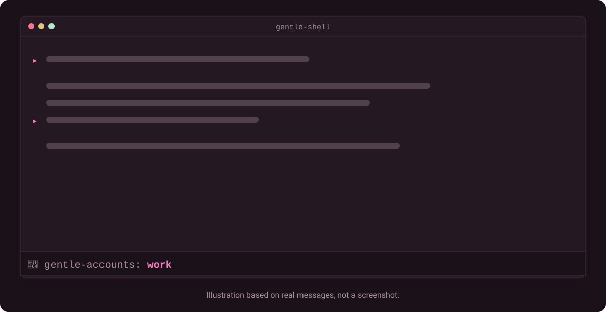
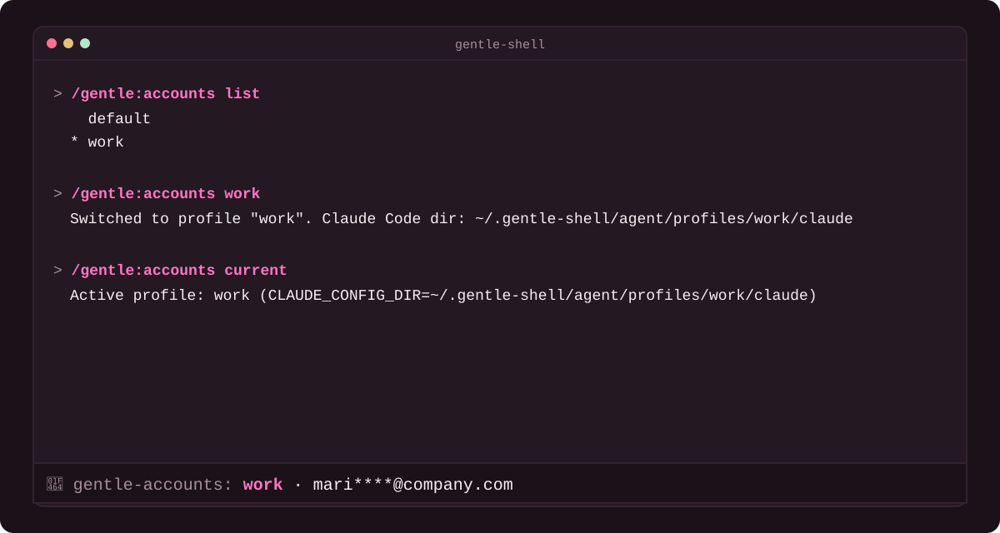
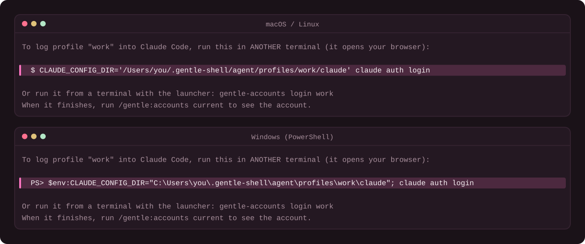

<p align="center"></p>

Español | [English](README.en.md)

> Los mensajes del programa se muestran en inglés.

Varias cuentas de Claude, Codex y Anthropic en Gentle Shell y pi, con un solo comando para cambiar entre ellas.

[](https://github.com/fcireza/gentle-accounts/actions/workflows/ci.yml) [](https://github.com/fcireza/gentle-accounts/releases)

> **Antes se llamaba gentle-profiles.** El comando `/profile` ahora es `/gentle:accounts`.



Las imágenes son ilustraciones construidas con los mensajes reales del programa, no capturas de pantalla.

## Objetivo

Claude Code guarda una sola sesión por equipo, y pi guarda las credenciales de Codex y Anthropic en un único `auth.json`. gentle-accounts permite tener **perfiles** con nombre, como `work` y `personal`, cada uno con sus propias sesiones. Se cambia entre ellos con un solo comando y la barra de estado siempre muestra qué cuenta está activa.

## Proveedores

| Proveedor | Qué guarda cada perfil | Cómo iniciar sesión |
| --- | --- | --- |
| Claude (mediante [pi-claude-bridge](https://github.com/elidickinson/pi-claude-bridge)) | su propia sesión de Claude Code (un `CLAUDE_CONFIG_DIR` separado) | `/gentle:accounts login claude` o `gentle-accounts login <profile>` |
| Codex (`openai-codex`) | sus propias credenciales en el `auth.json` de pi | el `/login` de pi |
| Anthropic (proveedor nativo de pi) | sus propias credenciales en el `auth.json` de pi | el `/login` de pi |

Cualquier otro proveedor configurado en pi queda intacto.

## Inicio rápido

Instalar en Gentle Shell y reiniciarlo:

```sh
gentle-shell -- install git:github.com/fcireza/gentle-accounts
```

1. Crear un perfil: `/gentle:accounts create work`
2. Cambiar a ese perfil: `/gentle:accounts work`
3. Iniciar sesión en Claude: `/gentle:accounts login claude` muestra un comando para ejecutar en otra terminal.
4. Comprobar la cuenta: `/gentle:accounts current`. La barra de estado muestra `gentle-accounts: work · mari****@company.com`.





El inicio de sesión no se ejecuta desde dentro de la TUI; `gentle-accounts login <profile>` lo ejecuta directamente desde una terminal.

## Instalación

| | Gentle Shell | pi sin Gentle Shell |
| --- | --- | --- |
| Comando | `gentle-shell -- install git:github.com/fcireza/gentle-accounts` | `pi install git:github.com/fcireza/gentle-accounts` |
| Carpeta del agente | `~/.gentle-shell/agent` (o `GENTLE_SHELL_HOME`) | `~/.pi/agent` (o `PI_CODING_AGENT_DIR`) |

Requisitos: Node 22.18 o superior, pi 1.5.1 o superior (o Gentle Shell), la CLI `claude` y pi-claude-bridge para los perfiles de Claude.

### macOS

```sh
gentle-shell -- install git:github.com/fcireza/gentle-accounts
pi install git:github.com/fcireza/gentle-accounts
```

Carpeta del agente: `~/.gentle-shell/agent`. Alias del lanzador para zsh (`~/.zshrc`) o bash (`~/.bashrc`):

```sh
alias gentle-accounts='node ~/.gentle-shell/agent/git/github.com/fcireza/gentle-accounts/bin/gentle-accounts.mjs'
```

### Linux

```sh
gentle-shell -- install git:github.com/fcireza/gentle-accounts
pi install git:github.com/fcireza/gentle-accounts
```

Carpeta del agente: `~/.gentle-shell/agent`. Alias del lanzador para bash (`~/.bashrc`) o zsh (`~/.zshrc`):

```sh
alias gentle-accounts='node ~/.gentle-shell/agent/git/github.com/fcireza/gentle-accounts/bin/gentle-accounts.mjs'
```

### Windows (PowerShell)

```powershell
gentle-shell -- install git:github.com/fcireza/gentle-accounts
pi install git:github.com/fcireza/gentle-accounts
```

Carpeta del agente: `%USERPROFILE%\.gentle-shell\agent`. Función del lanzador para el perfil de PowerShell (`$PROFILE`):

```powershell
function gentle-accounts { node "$env:USERPROFILE\.gentle-shell\agent\git\github.com\fcireza\gentle-accounts\bin\gentle-accounts.mjs" @args }
```

Para más detalles, actualizar, desinstalar o quitar el paquete anterior, consultar [Instalación](docs/es/install.md).

## Comandos

| Dentro de Gentle Shell o pi | Qué hace |
| --- | --- |
| `/gentle:accounts` | Abre un selector de perfiles. |
| `/gentle:accounts <name>` | Cambia a `<name>`. |
| `/gentle:accounts list` | Lista los perfiles; `*` marca el activo. |
| `/gentle:accounts current` | Muestra el perfil activo y actualiza la barra de estado. |
| `/gentle:accounts create <name>` | Crea un perfil vacío. |
| `/gentle:accounts delete <name>` | Elimina un perfil, previa confirmación. |
| `/gentle:accounts login claude` | Muestra el comando de inicio de sesión en Claude del perfil activo. |
| `/gentle:accounts help` | Muestra la lista de comandos. |

| Desde la terminal | Qué hace |
| --- | --- |
| `gentle-accounts <name> [args...]` | Inicia `gentle-shell` con ese perfil. |
| `gentle-accounts list` | Lista los perfiles. |
| `gentle-accounts current` | Muestra el perfil activo. |
| `gentle-accounts create <name>` | Crea un perfil vacío. |
| `gentle-accounts login <name>` | Ejecuta `claude auth login` para ese perfil. |
| `gentle-accounts --help` | Muestra la lista de comandos. |

La referencia completa, con cada mensaje, está en [Comandos](docs/es/commands.md).

## Documentación

- [Índice](docs/es/README.md): punto de partida de la documentación.
- [Instalación](docs/es/install.md): cada sistema, Gentle Shell y pi, alias, actualizar y desinstalar.
- [Flujo de trabajo](docs/es/workflow.md): escenarios completos con imágenes.
- [Comandos](docs/es/commands.md): referencia completa con cada mensaje.
- [Cómo funciona](docs/es/how-it-works.md): estructura en disco, cambio de perfil, barra de estado y seguridad.
- [Solución de problemas](docs/es/troubleshooting.md): síntomas, causas y soluciones.
- [Desarrollo](docs/es/development.md): tests, CI, Conventional Commits y versiones.

## Gentle Hub

Este repositorio tiene los topics `gentle-shell-package` y `gentle-shell-extension` para aparecer en el [Gentle Hub](https://gentlemanprogramming.com/gentle-hub/).

## Licencia

MIT
