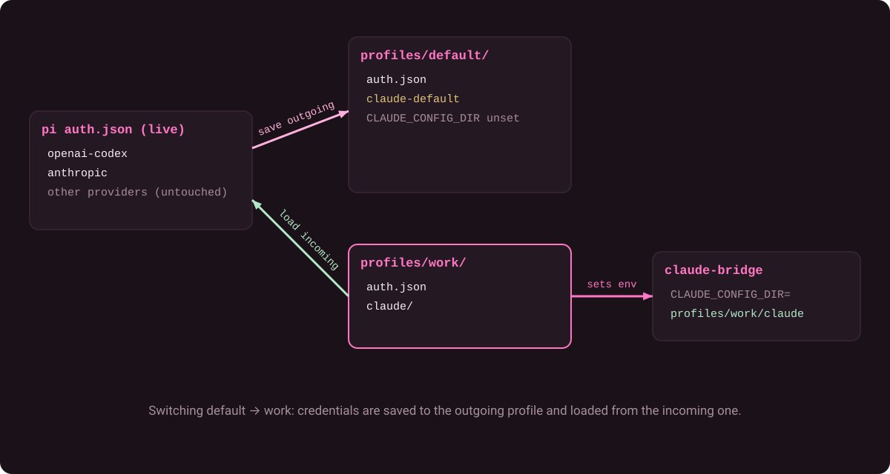

[Español](../es/how-it-works.md) | English

# How it works

What you will find here: where profiles live on disk, what happens step by step when you switch, why `CLAUDE_CONFIG_DIR` stays unset for `default`, how the status bar detects the account, and the security rules.



## On-disk layout

Everything lives under pi's agent dir (`~/.gentle-shell/agent` for Gentle Shell, `~/.pi/agent` for plain pi):

```
profiles/
  current             the active profile name
  startup             optional: the profile new sessions start on
  work/
    claude/           this profile's Claude Code login
    auth.json         this profile's account (oauth) credentials
  default/
    claude-default    marker: use Claude Code's default folder, CLAUDE_CONFIG_DIR unset
    auth.json
```

- `profiles/current` holds the name of the active profile. A name that does not match an existing profile counts as no active profile.
- `profiles/startup` holds the session profile name, written by `session <name>` and removed by `session last`. When it is absent, or names a profile that no longer exists, new sessions start on the last used profile.
- `<name>/claude/` is the profile's `CLAUDE_CONFIG_DIR`, the folder where Claude Code keeps that profile's login. pi-claude-bridge reads `CLAUDE_CONFIG_DIR` from the process environment.
- `<name>/auth.json` holds the profile's covered entries, in pi's `auth.json` format. Covered means `openai-codex`, `anthropic` and every other provider whose entry is `"type": "oauth"`; API-key providers (such as `google`) stay global and are never moved. A folder without `auth.json` is not a profile.
- `claude-default` is an empty marker: the profile uses Claude Code's built-in default folder and `CLAUDE_CONFIG_DIR` must be unset.
- `claude-dir` holds an explicit folder instead. It is written when `default` is created while you had `CLAUDE_CONFIG_DIR` set. A legacy `claude-dir` that points at `~/.claude` is treated like the `claude-default` marker.

All paths are built with Node's `path` functions, so the same layout works on Linux, macOS and Windows.

## The linked credentials file

On macOS and Linux the credentials file pi reads (`auth.json` in the agent dir) is a link to the current profile's own file, `profiles/<name>/auth.json`:

- Switching a profile repoints the link. No OAuth credentials are copied in either direction, and a token pi rotates is saved directly in the profile's file.
- The first time the extension starts outside a launcher session, an existing regular file is migrated once: its contents go into the current profile's file (the fresher OAuth entry per provider wins) and the link replaces it. It shows `Each profile now keeps its own logins: the credentials file is linked to profile "<name>".`
- API keys (providers that are not OAuth, such as `google`) stay global: on a switch they are carried to the profile you switch to. The live ones win on a conflict, a key only that profile has is kept, and a switch never deletes a key.
- A `/login` made directly in pi, outside the accounts menu, is saved in the CURRENT profile and replaces that provider's token there. A login that belongs to another account must be done from the accounts menu (it switches to the profile first) or in a session started with `gentle-accounts <profile>`.
- If the link cannot be made, or on Windows, nothing changes: the copy model stays, where credentials are saved into the outgoing profile and loaded from the incoming one, as described in the rest of this page.

## The session profile at session start

At session start the extension first creates `default` when no profile is active, or applies the active profile's `CLAUDE_CONFIG_DIR`. Then, if a session profile is set and is not the active one, it switches to it with the same safe switch as `/gentle:accounts <name>`: every file is read before any is written, the outgoing profile's covered credentials are saved, and `CLAUDE_CONFIG_DIR` is set or removed (removed for `default`). It then shows `Started on profile "<name>" (session profile).`. When the session profile is already active nothing changes. If a file cannot be read, it shows `gentle-accounts: <message>` (error), nothing changes and the session keeps working on the last used profile.

The session profile switch is skipped when `GENTLE_ACCOUNTS_LAUNCH_PROFILE` is set (not empty): the launcher sets it when it starts gentle-shell with `gentle-accounts <name>`, which already switched to `<name>`. If `profiles/startup` names a profile that no longer exists, session start shows `Session profile "<name>" does not exist; starting on the last used profile.` (warning) and nothing changes. The session profile switch only happens when pi starts. It does not run on `/new`, `/resume`, `/fork` or `/reload`, so a profile you switched to by hand stays active.

### A different account per session

A session started without the launcher uses the global profile: `profiles/current` and the single `auth.json` that every such session shares. Switching profile in one of them changes the covered credentials (Codex, Anthropic and any other OAuth login) the others read: on macOS and Linux the shared link now points at another profile's file.

A session started with `gentle-accounts <name>` gets its own private agent home instead, so several projects can run at the same time with a different account each:

1. The launcher creates `<tmp>/gentle-accounts-<uid>/<uuid>` (`<tmp>/gentle-accounts/<uuid>` on Windows) with `0700` permissions. On POSIX it refuses a base folder that is a symlink, owned by another user or writable by group or others: `gentle-accounts: refusing to use <path>: <reason>`.
2. Every entry of the shared agent dir is linked into it, except `auth.json`, `settings.json`, `auth.json.*`, `*.lock` and names starting with `.gentle-` (on Windows folders become junctions and files fall back to a hard link, then a copy).
3. The home gets its own `auth.json`: on macOS and Linux a link to that profile's own file, so two sessions on the same profile share one file and see each other's rotated token; on Windows, or if linking fails, a private copy (`0600`) of the profile's credentials. It also gets its own `settings.json` (a copy of the shared one with relative package paths made absolute) and a marker `.gentle-accounts-session.json`.
4. It runs `gentle-shell --home <home>` with `GENTLE_SHELL_NO_AUTO_SETUP=1`, `GENTLE_ACCOUNTS_LAUNCH_PROFILE=<name>` and the profile's `CLAUDE_CONFIG_DIR`.
5. When gentle-shell exits (any exit code, Ctrl+C or a kill signal), the launcher removes the home without following links. With a link nothing needs copying back; a private copy is merged back first, its covered entries into the profile. The next launch also cleans up homes whose launcher and gentle-shell processes are gone.

Tools that start the agent for you (for example herdr, one pane per project) cannot pass a profile name, and a session they start directly with `gentle-shell` or pi shares the global profile, so a switch in one pane changes every pane. Set `GENTLE_ACCOUNTS_PROFILE=<name>` in that pane or project and use `gentle-accounts` as the agent command: with no `<name>` (arguments starting with `-` go to gentle-shell) it launches that profile in its own private home, exactly like `gentle-accounts <name>`. An explicit `<name>` wins; an unknown profile fails with `Profile "<name>" does not exist.`; an empty variable is ignored.

Inside such a session the extension reads profiles from the shared agent dir, but the live credentials are the home's `auth.json` and the session's current profile is stored in the home (`.gentle-accounts-current`), never in `profiles/current`. A switch inside the session only changes that session. The session profile is not applied there; the menu shows the mode `session home`.

When credentials are merged (a private copy merged back, a migration, or a save on a switch in the copy model), the freshest login wins per provider: the OAuth entry with the later expiry is kept, so a session that ends later never overwrites a token that another session refreshed.

Known limit: Codex and Anthropic OAuth logins use rotating refresh tokens. Using the SAME account in two live sessions at once can make one of them invalidate the token the other holds, and that session then has to log in again. Prefer a different account (profile) per session.

Known limit: a session build that adds global keys, and a profile switch that does, can still race a token rotation by another live session on the same profile, because there is no lock. Re-reading the profile file right before writing narrows that window, it does not remove it.

## Switching, step by step

`/gentle:accounts <name>` (and the menu) run these steps. In a session started by the launcher, "live `auth.json`" means the home's own file and the current profile is stored in the home:

1. Check that the target exists and that its `auth.json` can be read. If not, stop before creating anything.
2. If no profile is active, create `default` from the current logins first (see [Workflow](workflow.md)).
3. If the target is already active, stop with `Already on profile "<name>".`
4. Read every file before writing any: pi's live `auth.json`, the target's `auth.json` and the outgoing profile's `auth.json`. A corrupt file stops the switch with `Cannot parse <path>: <reason>` and nothing is written.
5. Linked file (macOS and Linux): point the link at the target's own file. No OAuth credentials are copied in either direction. Copy model (Windows, or the link could not be made): save outgoing, copying the live covered entries into the outgoing profile's `auth.json` (an entry missing from the live file is removed from the saved copy).
6. Linked file: carry the API keys (entries that are not OAuth) to the target's file; the live ones win on a conflict, a key only the target has is kept and a key is never deleted. Copy model: load incoming, copying the target's covered entries into pi's live `auth.json`, removing those that the target does not have; API-key entries of other providers are left as they are.
7. Set `CLAUDE_CONFIG_DIR` to the target's Claude folder, or delete the variable for a profile on Claude Code's default folder (it is deleted, never set to the text `undefined`).
8. Write the target name into `profiles/current`.

Every `auth.json` is written to a temporary file next to it and then renamed over the original, so a reader never sees a half-written file. A write to the linked credentials file goes through the link to the file it points to; it never replaces the link. pi reloads `auth.json` when it changes. Files are created with `0600` permissions and profile folders with `0700`, on systems that honor them.

In the extension, the switch also reloads pi's model registry and refreshes the status bar. The launcher does not switch: it builds a session home (see above).

On session start, the extension also sets `CLAUDE_CONFIG_DIR` for the active profile, unless the environment already sets it, so the bridge uses the right login even when you start Gentle Shell without the launcher.

## Renaming a profile

1. Every refusal comes first, before anything is touched: the old profile exists, the names differ, the new name is valid and not reserved, and `profiles/<new>` does not exist (a leftover folder counts).
2. Session homes whose launcher is gone are finished, so their credentials are saved under the old name. Then a launcher session that is still running on the profile blocks the rename.
3. `profiles/<old>/` moves to `profiles/<new>/` with one directory rename, retried briefly on Windows lock errors. Credentials are never copied.
4. The files that named the old profile are rewritten: `profiles/current` (and the session's own current file), `profiles/startup`, and a `claude-dir` override that pointed inside the old folder. An external override is left alone.
5. `CLAUDE_CONFIG_DIR` of this process is set to the new Claude folder only when it held the old one, so a value you set yourself is respected.

If a step after the move fails, the folder and the files already rewritten are put back and the original error is shown. Sessions that were already running on the profile keep the old `CLAUDE_CONFIG_DIR` until they switch or restart, which is why the success message says so.

## Why `CLAUDE_CONFIG_DIR` stays unset for `default`

On macOS, Claude Code stores the login in the keychain, and the entry depends on the configured folder. Setting `CLAUDE_CONFIG_DIR` to the default path is therefore not the same as leaving it unset. This was measured on macOS with `claude auth status`:

| Environment | Result |
| --- | --- |
| `CLAUDE_CONFIG_DIR` unset | logged in, with the email |
| `CLAUDE_CONFIG_DIR=$HOME/.claude` | not logged in |
| an empty custom folder | not logged in |

So `default` gets the `claude-default` marker and the variable is removed while it is active, in the extension and in the child environment of the launcher. `/gentle:accounts current` shows `CLAUDE_CONFIG_DIR=(unset: Claude Code default)`, and the login command for `default` is plain `claude auth login`. The same measurement was not repeated on Linux or Windows (not verified).

## Detected logins

The menu looks for logins that no profile owns and offers them with `i`:

- A Claude account in `~/.claude` that no profile uses. Adopting it creates a profile on Claude Code's default dir; nothing is copied or moved. This still works with the linked file.
- A Codex account in the live `auth.json` whose `accountId` differs from the one in the active profile's saved copy and is in no other profile. Adopting it copies that entry into a new profile and makes it current. The previous profile keeps its own account. Detected logins can no longer be adopted while the credentials file is linked: a `/login` made directly in pi is saved in the current profile, so the menu refuses with `Cannot adopt a live login while the credentials file is linked to a profile: a login made there is saved in the current profile.` Log the other account in from the accounts menu or in a session started with `gentle-accounts <profile>` instead.

Anthropic entries carry no account id, so a new Anthropic login cannot be told apart from a token refresh and is not detected. Detection is read-only, runs only outside launcher sessions, and an unreadable `auth.json` detects nothing.

## Logging a provider out

`x` on a logged-in provider row removes that provider's entry from the profile's `auth.json`, and from the live `auth.json` too when the profile is the current one. Other profiles and API keys are not touched, and every file is read before any is written, so a corrupt file changes nothing. The token is only forgotten on this machine; it is not revoked at the provider.

Claude's login lives in its own config dir, which can be the default one shared with other tools, so the menu asks to confirm (and warns when the folder is shared) and runs `claude auth logout` with the profile's `CLAUDE_CONFIG_DIR`. With email display on, Codex and the other OAuth providers also show the account email when the credential carries one (read locally from the saved token; never verified).

## The status bar

The extension shows the account with pi's `setStatus`, under the key `gentle-accounts`. Gentle Shell shows it in its status bar and sidebar.

- Logged in: `👤 gentle-accounts: <profile>`, for example `👤 gentle-accounts: work`. The email is hidden by default and not shown at all; with `/gentle:accounts email show` the full address appears after the profile, for example `👤 gentle-accounts: work · maria.lopez@company.com`.
- Not logged in: `🔒 gentle-accounts: <profile> · not logged in`, for example `🔒 gentle-accounts: work · not logged in`.

The icon tells the two states apart at a glance: `👤` means a Claude login was detected for the profile, `🔒` means it was not.
- No active profile: the status is cleared.

Email display: while hidden, no email appears anywhere, not even masked. With `showEmail` set to `true` the status bar shows the full address and the menu shows it masked after three characters (`mar****@company.com`). The status bar text uses the theme colors: `muted` for the label, `accent` for the profile, `text` for the email and `warning` for `not logged in`.

Detection:

1. Run `claude auth status` with the profile's `CLAUDE_CONFIG_DIR` (or without it for `default`), with fixed arguments and a 5 second timeout. Its JSON answer gives `loggedIn` and `email`.
2. If the `claude` CLI is missing, times out or prints no JSON, read `oauthAccount.emailAddress` from `.claude.json` in the profile's Claude folder (and from `~/.claude.json` for the default folder).

Refresh: on session start, after a switch, on `/gentle:accounts current`, after every agent turn and every 60 seconds. A refresh already running for the same profile is skipped, and a result for a profile that is no longer active is dropped. A login done in another terminal shows up on its own within a minute.

Email display setting: `/gentle:accounts email [show|hide]` and `gentle-accounts email [show|hide]` store it in `profiles/settings.json` under the key `showEmail` (default `false`). Only a literal `true` shows the full email. A missing, empty or invalid file means hidden and is never rewritten when it is read. Writing keeps any other key and uses the same atomic write as the credentials files (temporary file, then rename) with `0600` permissions. The file is global to the agent dir and is read on every status refresh.

The full email is only ever written to the status bar, and only when the setting is shown: no notification, command output, log or image contains it, in either mode.

Codex shows no email, because pi stores only an opaque account id for it (from the existing README, not verified against pi's source).

## Security

- Tokens are never printed: the status and notifications only use the profile name; the full email appears only in the status bar, and only after `/gentle:accounts email show`. With it shown, anyone who sees your screen can read it.
- `profiles/settings.json` is written with `0600` permissions.
- Credentials files, `profiles/current` and `profiles/startup` are written with `0600` permissions.
- Nothing leaves your machine: the package only reads and writes local files and runs the local `claude` CLI. It makes no network requests of its own; `claude auth login` and pi's `/login` talk to their providers as usual.
- Commands are run with fixed arguments; on Windows they go through the shell only to resolve `.cmd` shims.

## Not supported on purpose

- Logging in from the extension uses the provider's own OAuth flow, so providers without an OAuth login (and the `/login` list itself) stay in pi.
- Adding entries to Gentle Shell's command menu: it is a fixed list that extensions cannot extend, so the entry points are `/gentle:accounts` (and its menu) and the status bar.
- Switching during an agent turn.
- Deleting the active profile, or deleting from the launcher.
- Renaming a profile that a running launcher session uses: close the session first.
- Swapping API-key providers other than `openai-codex` and `anthropic` (OAuth providers and Claude through `CLAUDE_CONFIG_DIR` are swapped).
- The old `/profile` command: it was renamed to `/gentle:accounts`.
