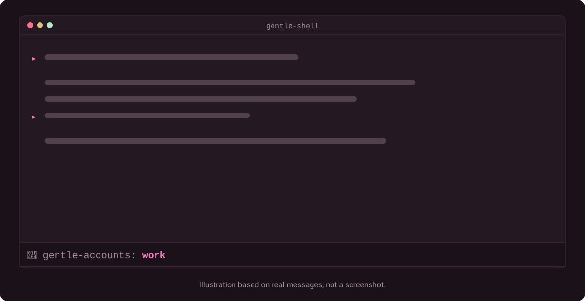
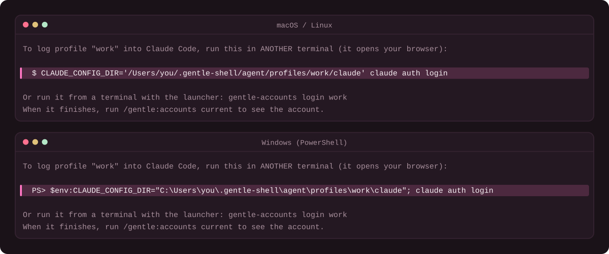
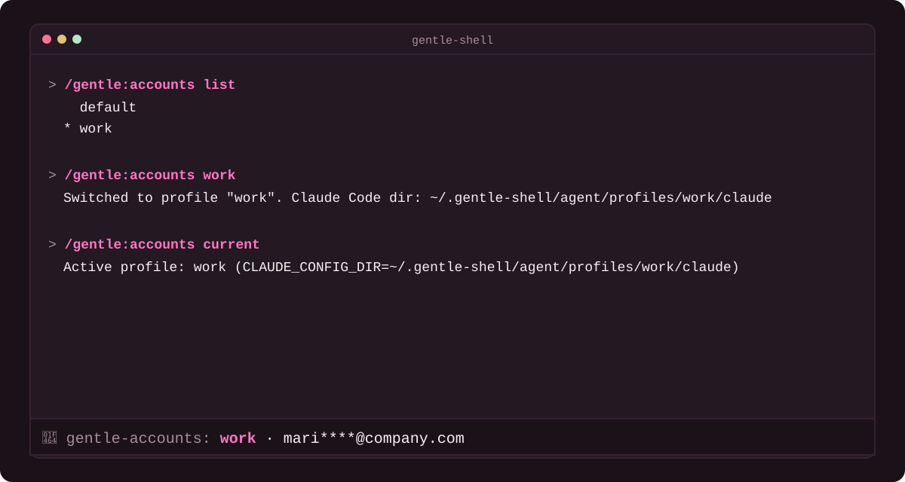

[Español](../es/workflow.md) | English

# Workflow

What you will find here: worked scenarios from the first start to deleting a profile, with the messages you will see.



## 1. First start and the `default` profile

After installing, restart Gentle Shell or pi. On session start, when no profile is active yet, the extension wraps your current logins into a profile called `default`:

- Your current Codex and Anthropic credentials in pi's `auth.json` are copied into `profiles/default/auth.json`.
- Your Claude Code login is not moved or copied. `default` keeps using Claude Code's own default folder, and `CLAUDE_CONFIG_DIR` is left **unset** while it is active. See [How it works](how-it-works.md) for why.
- If you had set `CLAUDE_CONFIG_DIR` yourself, that folder is recorded (not copied) and kept.

Check it:

```
/gentle:accounts current
```

```
Active profile: default (CLAUDE_CONFIG_DIR=(unset: Claude Code default))
```

## 2. A work and a personal Claude account

In this example `default` already holds your personal account and you add `work`.

Create the profile:

```
/gentle:accounts create work
```

```
Created profile "work". Switch with /gentle:accounts work, then /login for Codex or Anthropic and /gentle:accounts login claude for Claude.
```

Switch to it:

```
/gentle:accounts work
```

The profile has an empty Claude folder, so it is not logged in yet. Ask for the login command:

```
/gentle:accounts login claude
```



On macOS or Linux the message looks like this:

```
To log profile "work" into Claude Code, run this in ANOTHER terminal (it opens your browser):

  $ CLAUDE_CONFIG_DIR='/Users/you/.gentle-shell/agent/profiles/work/claude' claude auth login

Or run it from a terminal with the launcher: gentle-accounts login work
When it finishes, run /gentle:accounts current to see the account.
```

On Windows (PowerShell):

```
To log profile "work" into Claude Code, run this in ANOTHER terminal (it opens your browser):

  PS> $env:CLAUDE_CONFIG_DIR="C:\Users\you\.gentle-shell\agent\profiles\work\claude"; claude auth login

Or run it from a terminal with the launcher: gentle-accounts login work
When it finishes, run /gentle:accounts current to see the account.
```

Copy the command after `$ ` or `PS> ` and run it in another terminal. For `default` the command is plain `claude auth login`, with no `CLAUDE_CONFIG_DIR` prefix.

Alternative: if you set up the launcher alias ([Installation](install.md)), run this in a terminal instead. It runs `claude auth login` for that profile's Claude folder with the terminal attached:

```sh
gentle-accounts login work
```

When the browser flow ends, check the account:

```
/gentle:accounts current
```

The status bar then reads `👤 gentle-accounts: work · mari****@company.com`.

### Why the login is not run from inside the TUI

`claude auth login` is interactive: it opens a browser and waits for you. The pi TUI owns the terminal, so a child process would fight it for the screen and the keyboard. That is why `/gentle:accounts login claude` only prints the command, and the launcher's `gentle-accounts login <profile>` is the supported way to run it directly.

## 3. Codex or Anthropic credentials

Codex (`openai-codex`) and Anthropic (pi's native `anthropic` provider) use pi's normal `/login`. While a profile is active, run:

```
/login
```

pi writes the credentials into its live `auth.json`. They are saved into the active profile's `auth.json` the next time you switch away from that profile (with `/gentle:accounts <name>` or the launcher). Until then they only live in pi's `auth.json`. Credentials of other providers are never touched.

## 4. Switching back and forth



List profiles; `*` marks the active one:

```
/gentle:accounts list
```

```
* default
  work
```

Switch by name, or run `/gentle:accounts` with no argument to pick from a list:

```
/gentle:accounts default
```

```
Switched to profile "default". Claude Code dir: (unset: Claude Code default)
```

Switching to the profile that is already active only says `Already on profile "default".`. Switching waits for the agent: while a turn is running you get `Wait for the current turn to finish before switching profiles.`

Reading the status bar: `👤 gentle-accounts: <profile> · <masked email>` when the profile's Claude login is detected, `🔒 gentle-accounts: <profile> · not logged in` otherwise. The icon shows the state at a glance: `👤` logged in, `🔒` not logged in. The email is masked, for example `mari****@company.com`. The status refreshes on start, after a switch, on `/gentle:accounts current`, after every agent turn and every 60 seconds.

## 5. Starting a session on a profile

With the launcher alias, start Gentle Shell already on a profile. Extra arguments are passed to `gentle-shell`:

```sh
gentle-accounts work
```

The launcher does the same switch as `/gentle:accounts work` (creating `default` first when no profile is active), then starts `gentle-shell` with `CLAUDE_CONFIG_DIR` set for that profile, or removed for `default`.

## 6. Choose the profile new sessions start on

By default a new session starts on the last used profile. To always start on `work`, set it as the startup profile:

```
/gentle:accounts startup work
```

```
Startup profile set to "work". New sessions start on it.
```

Restart Gentle Shell or pi. If another profile was active, the session switches to `work` on start and shows `Started on profile "work" (startup profile).`. To go back to the last used profile:

```
/gentle:accounts startup last
```

```
Startup profile cleared. New sessions start on the last used profile.
```

The startup profile is shared by every session of the same agent dir; see the known limit in [How it works](how-it-works.md).

## 7. Deleting a profile

You cannot delete the active profile or the startup profile, so switch away (or run `startup last`) first:

```
/gentle:accounts default
/gentle:accounts delete work
```

A confirmation dialog asks `Delete profile "work" and its Claude login and credentials? This cannot be undone.`. Confirm to get `Deleted profile "work".`, or cancel to get `Delete cancelled.`. The whole profile folder is removed, including its Claude login folder. The launcher has no delete command.
