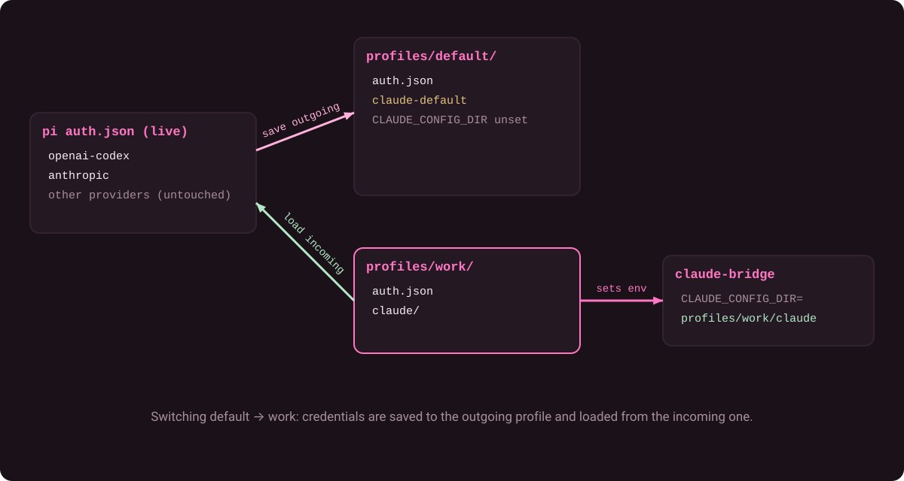

[English](../en/how-it-works.md) | Español

# Cómo funciona

Qué encontrará aquí: dónde viven los perfiles en disco, qué ocurre paso a paso al cambiar de perfil, por qué `CLAUDE_CONFIG_DIR` queda sin definir para `default`, cómo la barra de estado detecta la cuenta, y las reglas de seguridad.



## Estructura en disco

Todo vive dentro de la carpeta del agente de pi (`~/.gentle-shell/agent` para Gentle Shell, `~/.pi/agent` para pi):

```
profiles/
  current             the active profile name
  work/
    claude/           this profile's Claude Code login
    auth.json         this profile's Codex / Anthropic credentials
  default/
    claude-default    marker: use Claude Code's default folder, CLAUDE_CONFIG_DIR unset
    auth.json
```

- `profiles/current` guarda el nombre del perfil activo. Un nombre que no corresponde a un perfil existente equivale a no tener perfil activo.
- `<name>/claude/` es el `CLAUDE_CONFIG_DIR` del perfil, la carpeta donde Claude Code guarda el inicio de sesión de ese perfil. pi-claude-bridge lee `CLAUDE_CONFIG_DIR` del entorno del proceso.
- `<name>/auth.json` guarda las entradas del perfil para los proveedores `openai-codex` y `anthropic`, con el formato del `auth.json` de pi. Una carpeta sin `auth.json` no es un perfil.
- `claude-default` es un marcador vacío: el perfil usa la carpeta predeterminada de Claude Code y `CLAUDE_CONFIG_DIR` debe quedar sin definir.
- `claude-dir` guarda en cambio una carpeta explícita. Se escribe cuando `default` se crea mientras usted tenía `CLAUDE_CONFIG_DIR` definido. Un `claude-dir` antiguo que apunta a `~/.claude` se trata igual que el marcador `claude-default`.

Todas las rutas se construyen con las funciones de `path` de Node, así que la misma estructura funciona en Linux, macOS y Windows.

## El cambio de perfil, paso a paso

`/gentle:accounts <name>` y `gentle-accounts <name>` del launcher siguen los mismos pasos:

1. Comprobar que el destino existe y que su `auth.json` se puede leer. Si no, detenerse antes de crear nada.
2. Si no hay un perfil activo, crear primero `default` con los inicios de sesión actuales (consulte [Flujo de trabajo](workflow.md)).
3. Si el destino ya está activo, detenerse con `Already on profile "<name>".`
4. Leer todos los archivos antes de escribir alguno: el `auth.json` activo de pi, el `auth.json` del destino y el `auth.json` del perfil saliente. Un archivo corrupto detiene el cambio con `Cannot parse <path>: <reason>` y no se escribe nada.
5. Guardar el saliente: copiar las entradas activas de `openai-codex` y `anthropic` al `auth.json` del perfil saliente (una entrada que falta en el archivo activo se elimina de la copia).
6. Cargar el entrante: copiar las entradas `openai-codex` y `anthropic` del destino al `auth.json` activo de pi, eliminando las que el destino no tiene. Las entradas de cualquier otro proveedor quedan como estaban.
7. Definir `CLAUDE_CONFIG_DIR` con la carpeta de Claude del destino, o borrar la variable para un perfil en la carpeta predeterminada de Claude Code (se borra; nunca se le asigna el texto `undefined`).
8. Escribir el nombre del destino en `profiles/current`.

Cada `auth.json` se escribe en un archivo temporal a su lado y luego se renombra sobre el original, así un lector nunca ve un archivo a medio escribir. pi recarga `auth.json` cuando cambia. Los archivos se crean con permisos `0600` y las carpetas de perfil con `0700`, en los sistemas que los respetan.

En la extensión, el cambio además recarga el registro de modelos de pi y actualiza la barra de estado. El launcher, en cambio, inicia `gentle-shell` con el nuevo entorno.

Al iniciar la sesión, la extensión también define `CLAUDE_CONFIG_DIR` para el perfil activo, salvo que el entorno ya lo defina, para que el bridge use el inicio de sesión correcto aunque Gentle Shell se inicie sin el launcher.

## Por qué `CLAUDE_CONFIG_DIR` queda sin definir para `default`

En macOS, Claude Code guarda el inicio de sesión en el llavero, y la entrada depende de la carpeta configurada. Por eso definir `CLAUDE_CONFIG_DIR` con la ruta predeterminada no equivale a dejarlo sin definir. Esto se midió en macOS con `claude auth status`:

| Entorno | Resultado |
| --- | --- |
| `CLAUDE_CONFIG_DIR` sin definir | sesión iniciada, con el correo |
| `CLAUDE_CONFIG_DIR=$HOME/.claude` | sin sesión |
| una carpeta propia vacía | sin sesión |

Así que `default` recibe el marcador `claude-default` y la variable se elimina mientras está activo, en la extensión y en el entorno del proceso hijo del launcher. `/gentle:accounts current` muestra `CLAUDE_CONFIG_DIR=(unset: Claude Code default)`, y el comando de inicio de sesión para `default` es simplemente `claude auth login`. La misma medición no se repitió en Linux ni en Windows (no verificado).

## La barra de estado

La extensión muestra la cuenta con `setStatus` de pi, bajo la clave `gentle-accounts`. Gentle Shell la muestra en su barra de estado y en la barra lateral.

- Con sesión: `gentle-accounts: <profile> · <masked email>`, por ejemplo `gentle-accounts: work · mari****@company.com`.
- Sin sesión: `gentle-accounts: <profile> · not logged in`.
- Sin perfil activo: el estado se borra.

Máscara del correo: se conservan los primeros `min(4, max(1, len-3))` caracteres de la parte anterior a `@`, luego `****`, luego el `@domain` sin cambios. Ejemplos calculados con `maskEmail`:

| Correo | Se muestra como |
| --- | --- |
| `maria.lopez@company.com` | `mari****@company.com` |
| `fcireza@gmail.com` | `fcir****@gmail.com` |
| `ab@x.com` | `a****@x.com` |
| `abcde@x.com` | `ab****@x.com` |
| `no-at-sign` | `****` |

Detección:

1. Ejecutar `claude auth status` con el `CLAUDE_CONFIG_DIR` del perfil (o sin él para `default`), con argumentos fijos y un límite de 5 segundos. Su respuesta JSON da `loggedIn` y `email`.
2. Si falta la CLI `claude`, se agota el tiempo o no imprime JSON, leer `oauthAccount.emailAddress` de `.claude.json` en la carpeta de Claude del perfil (y de `~/.claude.json` para la carpeta predeterminada).

Actualización: al iniciar la sesión, después de un cambio, con `/gentle:accounts current`, después de cada turno del agente y cada 60 segundos. Una actualización que ya está en curso para el mismo perfil se omite, y el resultado de un perfil que ya no está activo se descarta. Un inicio de sesión hecho en otra terminal aparece solo en menos de un minuto.

Codex no muestra correo, porque pi solo guarda un identificador de cuenta opaco (según el README existente, no verificado contra el código de pi).

## Seguridad

- Los tokens nunca se imprimen: el estado y las notificaciones solo usan el nombre del perfil y el correo enmascarado; el correo completo nunca aparece.
- Los archivos de credenciales y `profiles/current` se escriben con permisos `0600`.
- Nada sale de su equipo: el paquete solo lee y escribe archivos locales y ejecuta la CLI `claude` local. No hace solicitudes de red propias; `claude auth login` y el `/login` de pi hablan con sus proveedores como siempre.
- Los comandos se ejecutan con argumentos fijos; en Windows pasan por la shell solo para resolver los shims `.cmd`.

## Lo que no se soporta a propósito

- Ejecutar `claude auth login` dentro de la TUI: es interactivo y la TUI controla la terminal; use el comando impreso o `gentle-accounts login <profile>`.
- Agregar entradas al menú de comandos de Gentle Shell: es una lista fija que las extensiones no pueden ampliar, así que los puntos de entrada son `/gentle:accounts` y la barra de estado.
- Cambiar de perfil durante un turno del agente.
- Borrar el perfil activo, o borrar desde el launcher.
- Intercambiar proveedores distintos de `openai-codex` y `anthropic` (más Claude mediante `CLAUDE_CONFIG_DIR`).
- El antiguo comando `/profile`: se renombró a `/gentle:accounts`.
