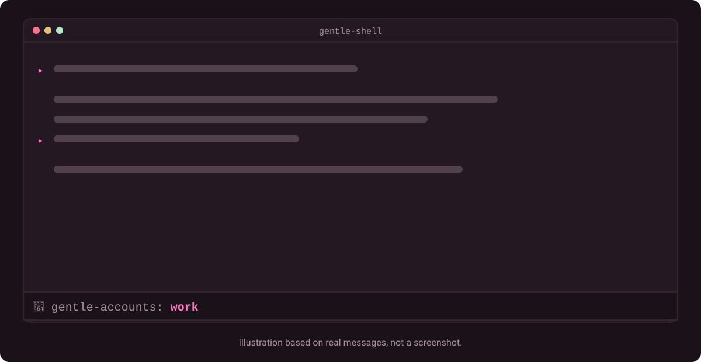
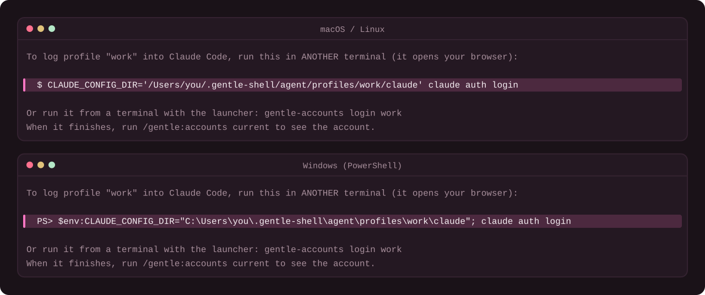
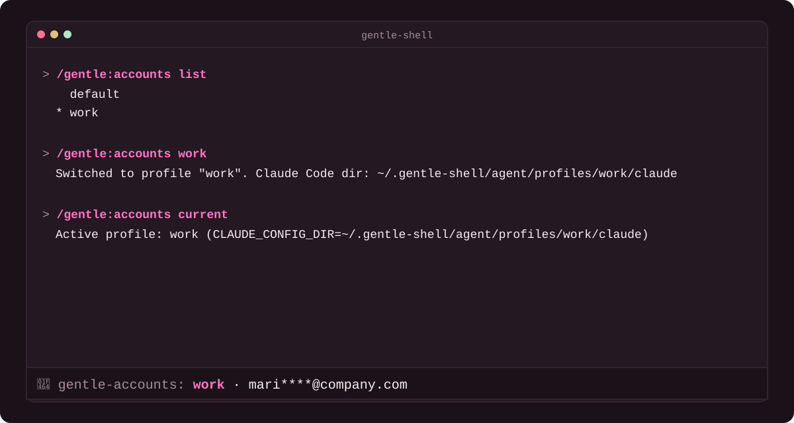

[English](../en/workflow.md) | Español

# Flujo de trabajo

Qué encontrará aquí: escenarios completos desde el primer inicio hasta borrar un perfil, con los mensajes que verá.



## 1. Primer inicio y el perfil `default`

Después de instalar, reinicie Gentle Shell o pi. Al iniciar la sesión, si todavía no hay un perfil activo, la extensión agrupa sus inicios de sesión actuales en un perfil llamado `default`:

- Las credenciales de cuenta actuales (Codex, Anthropic y cualquier otro login oauth) del `auth.json` de pi se copian a `profiles/default/auth.json`.
- El inicio de sesión de Claude Code no se mueve ni se copia. `default` sigue usando la carpeta predeterminada de Claude Code, y `CLAUDE_CONFIG_DIR` queda **sin definir** mientras está activo. Consulte [Cómo funciona](how-it-works.md) para saber por qué.
- Si había definido `CLAUDE_CONFIG_DIR` por su cuenta, esa carpeta se registra (no se copia) y se conserva.

Compruébelo:

```
/gentle:accounts current
```

```
Active profile: default (CLAUDE_CONFIG_DIR=(unset: Claude Code default))
```

## 2. Una cuenta de Claude de trabajo y una personal

En este ejemplo `default` ya tiene la cuenta personal y se agrega `work`.

Cree el perfil:

```
/gentle:accounts create work
```

```
Created profile "work". Switch with /gentle:accounts work, then /login for Codex or Anthropic and /gentle:accounts login claude for Claude.
```

Cambie a ese perfil:

```
/gentle:accounts work
```

El perfil tiene una carpeta de Claude vacía, así que todavía no tiene sesión iniciada. Pida el comando de inicio de sesión:

```
/gentle:accounts login claude
```



En macOS o Linux el mensaje se ve así:

```
To log profile "work" into Claude Code, run this in ANOTHER terminal (it opens your browser):

  $ CLAUDE_CONFIG_DIR='/Users/you/.gentle-shell/agent/profiles/work/claude' claude auth login

Or run it from a terminal with the launcher: gentle-accounts login work
When it finishes, run /gentle:accounts current to see the account.
```

En Windows (PowerShell):

```
To log profile "work" into Claude Code, run this in ANOTHER terminal (it opens your browser):

  PS> $env:CLAUDE_CONFIG_DIR="C:\Users\you\.gentle-shell\agent\profiles\work\claude"; claude auth login

Or run it from a terminal with the launcher: gentle-accounts login work
When it finishes, run /gentle:accounts current to see the account.
```

Copie el comando que sigue a `$ ` o `PS> ` y ejecútelo en otra terminal. Para `default` el comando es simplemente `claude auth login`, sin el prefijo `CLAUDE_CONFIG_DIR`.

Alternativa: si configuró el alias del launcher ([Instalación](install.md)), ejecute esto en una terminal. Corre `claude auth login` para la carpeta de Claude de ese perfil, conectado a la terminal:

```sh
gentle-accounts login work
```

Cuando termine el flujo del navegador, compruebe la cuenta:

```
/gentle:accounts current
```

La barra de estado muestra entonces `👤 gentle-accounts: work · mari****@company.com`.

### Otras formas de iniciar sesión

`claude auth login` es interactivo: abre un navegador y espera. `/gentle:accounts login claude` solo imprime el comando. El menú de cuentas (sección 9) también puede ejecutarlo: `Enter` en la fila de Claude ofrece `In a new terminal tab`, `In this terminal` (la TUI se pausa mientras `claude auth login` usa la terminal y vuelve al terminar) o `Show the command`. Desde una terminal, `gentle-accounts login <profile>` lo ejecuta directamente.

## 3. Credenciales de Codex o Anthropic

Codex (`openai-codex`) y Anthropic (el proveedor nativo `anthropic` de pi) usan el `/login` normal de pi. Con un perfil activo, ejecute:

```
/login
```

pi escribe las credenciales en su `auth.json` activo. Se guardan en el `auth.json` del perfil activo la próxima vez que cambie a otro perfil (con `/gentle:accounts <name>` o con el launcher). Hasta entonces solo están en el `auth.json` de pi. Las credenciales de otros proveedores nunca se tocan.

## 4. Cambiar de un perfil a otro



Liste los perfiles; `*` marca el activo:

```
/gentle:accounts list
```

```
* default
  work
```

Cambie por nombre, o ejecute `/gentle:accounts` sin argumentos para elegir de una lista:

```
/gentle:accounts default
```

```
Switched to profile "default". Claude Code dir: (unset: Claude Code default)
```

Cambiar al perfil que ya está activo solo indica `Already on profile "default".`. El cambio espera al agente: mientras hay un turno en curso aparece `Wait for the current turn to finish before switching profiles.`

Cómo leer la barra de estado: `👤 gentle-accounts: <profile> · <masked email>` cuando se detecta el inicio de sesión de Claude del perfil, `🔒 gentle-accounts: <profile> · not logged in` en caso contrario. El ícono muestra el estado de un vistazo: `👤` con sesión, `🔒` sin sesión. De forma predeterminada el correo aparece enmascarado, por ejemplo `mari****@company.com`; consulte la sección 7 para mostrarlo completo. El estado se actualiza al iniciar, después de un cambio, con `/gentle:accounts current`, después de cada turno del agente y cada 60 segundos.

## 5. Iniciar una sesión en un perfil

Con el alias del launcher, inicie Gentle Shell directamente en un perfil. Los argumentos extra se pasan a `gentle-shell`:

```sh
gentle-accounts work
```

El launcher no cambia el perfil global. Le da a la sesión una carpeta del agente privada con las credenciales del perfil, inicia `gentle-shell` en ella con `CLAUDE_CONFIG_DIR` definido para ese perfil (eliminado para `default`) y, cuando gentle-shell termina, copia las credenciales de la sesión de vuelta al perfil. Consulte la sección 10.

## 6. Elegir el perfil con el que empiezan las sesiones nuevas

De forma predeterminada, una sesión nueva empieza en el último perfil usado. Para empezar siempre en `work`, defínalo como perfil de inicio:

```
/gentle:accounts startup work
```

```
Startup profile set to "work". New sessions start on it.
```

Reinicie Gentle Shell o pi. Si había otro perfil activo, la sesión cambia a `work` al iniciar y muestra `Started on profile "work" (startup profile).`. Para volver al último perfil usado:

```
/gentle:accounts startup last
```

```
Startup profile cleared. New sessions start on the last used profile.
```

El perfil de inicio es compartido por todas las sesiones de la misma carpeta del agente; consulte el límite conocido en [Cómo funciona](how-it-works.md).

## 7. Mostrar el correo completo en la barra de estado

De forma predeterminada la barra de estado muestra un correo enmascarado, `👤 gentle-accounts: work · mari****@company.com`. Para ver la dirección completa:

```
/gentle:accounts email show
```

```
Email display set to shown. The status bar shows the full email.
```

La barra de estado se actualiza de inmediato y muestra `👤 gentle-accounts: work · maria.lopez@company.com`. Para volver a enmascararlo:

```
/gentle:accounts email hide
```

```
Email display set to hidden. The status bar shows a masked email.
```

Advertencia de privacidad: con `show`, cualquier persona que vea su pantalla puede leer la dirección, incluso al compartir pantalla, en capturas de pantalla y en grabaciones. Oculte el correo antes de compartir su pantalla. La opción se aplica a todas las sesiones de la misma carpeta del agente.

## 8. Borrar un perfil

No se puede borrar el perfil activo ni el perfil de inicio, así que primero cambie a otro (o ejecute `startup last`):

```
/gentle:accounts default
/gentle:accounts delete work
```

Un diálogo de confirmación pregunta `Delete profile "work" and its Claude login and credentials? This cannot be undone.`. Al confirmar aparece `Deleted profile "work".`; al cancelar, `Delete cancelled.`. Se borra toda la carpeta del perfil, incluida su carpeta de inicio de sesión de Claude. El launcher no tiene comando para borrar.

## 9. El menú de cuentas

Abra el menú (o ejecute `/gentle:accounts` sin argumentos):

```
/gentle:accounts menu
```

Hay una pestaña por perfil: `◉` marca el perfil activo en esta sesión y `★` el perfil de inicio. Cada pestaña muestra una fila por proveedor con `●` si hay sesión iniciada u `○` si no, y el correo enmascarado. Muévase con las flechas (o `h` `j` `k` `l`), presione `Enter` en la fila del perfil para cambiar a él o en una fila de proveedor para iniciar sesión, `n` para crear, `d` para borrar, `s` para el perfil de inicio, `e` para la visualización del correo, `o` para abrir este proyecto con el perfil seleccionado en una pestaña nueva de la terminal y `Esc` para cerrar. Todas las teclas y mensajes están en [Comandos](commands.md).

Iniciar sesión desde una fila de proveedor:

- Claude: elija `In a new terminal tab`, `In this terminal` o `Show the command`.
- Codex y Anthropic: el menú se cierra y escribe `/login` en el editor; presione Enter y elija el proveedor. Solo funciona para el perfil activo, así que primero cambie a él.

## 10. Una cuenta distinta en cada proyecto

Inicie cada proyecto con el launcher y su propio perfil, cada uno en su propia terminal:

```sh
gentle-accounts work
gentle-accounts personal
```

Cada sesión recibe una carpeta del agente privada, así que un cambio de perfil o un inicio de sesión en una no cambia la otra. Las sesiones iniciadas sin el launcher siguen usando el perfil global. Desde el menú, `o` abre el proyecto actual con el perfil seleccionado en una pestaña nueva; si no puede abrir una pestaña, muestra el comando que hay que ejecutar, por ejemplo `Open this project with "personal" in a new terminal: gentle-accounts personal`.

Es preferible usar una cuenta distinta en cada sesión: los refresh tokens de OAuth rotan, así que la MISMA cuenta en dos sesiones abiertas puede invalidar el token que tiene una de ellas, y esa sesión tendrá que iniciar sesión de nuevo. Detalles en [Cómo funciona](how-it-works.md).
